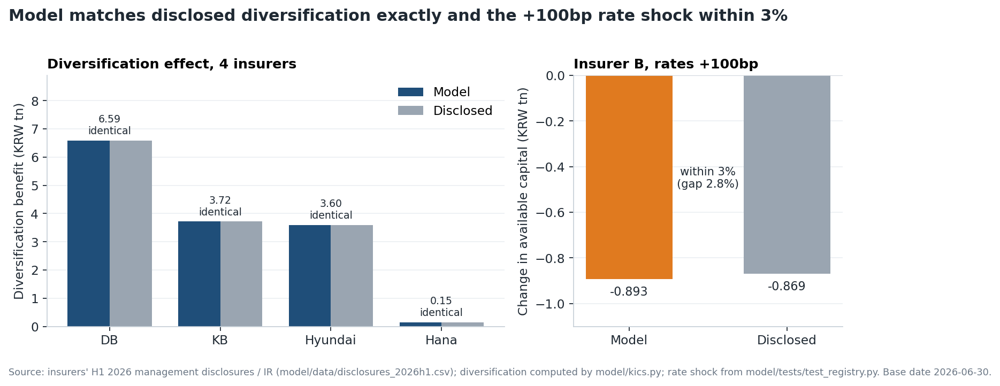
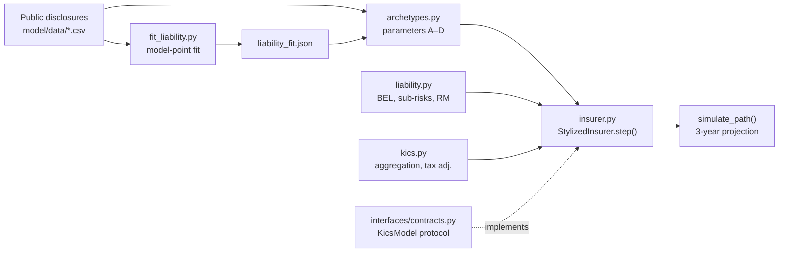

# ORSA Reverse Stress Test: Stylised K-ICS Insurer Model

A Python model of four stylised Korean non-life insurers, rebuilt from public disclosures, that projects the K-ICS ratio for three years and matches the disclosed +100bp rate-shock capital change within **3%** (KRW −0.893tn vs −0.869tn).


[](https://github.com/dduddokong/orsa-reverse-stress-test/actions/workflows/ci.yml)

<p align="center"></p>

| | |
|---|---|
| **Context** | 17th DB Insurance & Finance Contest, Aug 2026 – present (in progress) |
| **Role** | Team of 2 — I built the insurer model (this repo); the interface contract in `interfaces/` was written jointly; the reverse-stress optimiser is my teammate's part and is not included |
| **Stack** | Python 3.9 / 3.11, NumPy, SciPy, pandas, pytest, GitHub Actions |
| **Data** | Public (insurer disclosures and IR, FSS FISIS, BoK ECOS, FSS VA publications) — see [`data/README.md`](data/README.md) |

## Key results

- Diversification effect from the standard-model correlation matrix matches disclosures **exactly** for 4 insurers (DB, KB, Hyundai, Hana).
- Insurer B, rates +100bp: available-capital change **KRW −0.893tn** vs disclosed **KRW −0.869tn** (within 3%).
- Out-of-sample: ratio effect of the loss-ratio reform for A is **−3.8pp** vs ≈ **−4.4pp** observed (not fitted to this).
- One roll-forward takes about **1 ms**; **122** tests, including a registry test that fails if a validated number moves.

## Overview

From 2026, Korean insurers must run an **Own Risk and Solvency Assessment (ORSA)**. A reverse stress test asks which plausible scenario would push the solvency ratio below a threshold (the K-ICS recommended level of 130%), instead of how bad a given scenario is. In 2024–2026, regulator-driven changes to actuarial assumptions (the loss-ratio and lapse guidelines) moved non-life K-ICS ratios at least as much as market moves did, so the model treats both kinds of risk factor.

The optimiser needs an insurer model that is fast, deterministic and reasonably realistic: given a balance sheet, a year of risk-factor moves, a possible regulatory "regime jump" and a management action, return next year's balance sheet. This repository is that model.

## Approach



- **Four stylised insurers (A–D)** built from disclosures; every parameter has a recorded source.
- **Cash-flow liabilities:** three model points per insurer, fitted to disclosed sub-risk charges, CSM and duration.
- **K-ICS capital:** correlation aggregation, operational risk, tax adjustment, transitional measures, capital tiering.
- **Seven risk factors + two regime jumps** (loss-ratio and lapse reforms), and **four management actions** with state-dependent feasibility and cost.

## Validation

Against disclosures, base date 2026-06-30.

| Check | Model | Disclosed / observed | Note |
|---|---|---|---|
| Diversification effect from the standard-model correlation matrix (DB, KB, Hyundai, Hana) | −65,934 / −37,196 / −35,999 / −1,495 (KRW 100m) | identical | Confirms the aggregation is implemented correctly. Samsung Fire does not disclose this item. |
| Starting K-ICS ratio, A / B | 282.8% / 204.4% | 282.8% / 204.4% | C matches the top-5 aggregate. D is set to 150%. |
| Model-point fit, max log error (4 insurers with sub-risk disclosure) | 0.000–0.002 | — | Six proxy insurers: 0.003–0.311 |
| B: available-capital change, rates +100bp | **KRW −0.893tn** | **KRW −0.869tn** | Within 3%. The asset side is calibrated from the disclosed net sensitivity, so what this tests is the liability discount-curve coupling. |
| A: ratio effect of the loss-ratio reform (not fitted to this) | −3.8pp | ≈ −4.4pp (IR "regulatory change", Q2) | Out-of-sample check. The observed figure also includes other effects from the same quarter. |

The regression test `model/tests/test_registry.py` fixes these values. If a model change moves a validated number, the test fails.

## Reproduce

```bash
pip install -r requirements.txt        # or: conda env create -f environment.yml
python -m pytest -q                    # 122 tests
python reports/make_figures.py         # rebuilds reports/figures/hero.png
```

Everything is reproducible from the committed public data. Other entry points: `python -m model.report` (calibration table for A–D), `python -m model.sensitivity` (assumption sensitivity), `python -m model.fit_liability` (re-fit model points; rewrites `model/data/liability_fit.json`). The risk-factor model and optimiser are not included.

## Repository structure

```text
interfaces/contracts.py   KicsModel protocol, risk factors, Regime, Action, BalanceSheet
interfaces/mock.py        toy model used by the optimiser lane before the real model existed
interfaces/tests/         contract tests run against the mock and all four insurers
model/kics.py             standard-model aggregation and tax adjustment
model/liability.py        model-point cash flows, BEL, sub-risks, risk margin
model/fit_liability.py    fits model points to disclosures -> data/liability_fit.json
model/archetypes.py       disclosures -> parameters for insurers A-D
model/insurer.py          StylizedInsurer (roll-forward, actions, feasibility, cost), simulate_path
model/backtest.py         historical market moves vs IR ratio walk
model/sensitivity.py      one-at-a-time assumption sensitivity
model/report.py           calibration table for A-D
model/data/               disclosure figures with source URLs, market levels, VA history, fit output
model/tests/              unit, property/fuzz and registry regression tests
model/README.md           detailed model notes (Korean)
data/README.md            data sources (files live in model/data/)
reports/make_figures.py   builds the hero figure
reports/figures/          hero.png
.github/workflows/ci.yml  pytest on Python 3.9 and 3.11
```

## Limitations

- **The equity response is not reproduced** for A. A's equity holdings are concentrated in a single affiliate, and that position does not move with the KOSPI factor.
- **The no-shock baseline is somewhat optimistic** compared with the base insurer's IR "recurring" ratio drift.
- **Calibration range:** cumulative rates ±200bp, loss ratio ±10pp, lapse multiplier 0.5–2. Disclosed rate sensitivities only go to ±100bp. Outside this range the state is flagged `outside_calibration`.
- **The largest assumption uncertainty** is the spread duration of credit assets. `python -m model.sensitivity` sweeps each assumption ×0.5 / ×1.5.
- These are stylised insurers. They are not the companies' internal models, and the action limits (60% retention floor, 10% sub-debt cap, 40% equity floor) are provisional.

<details><summary><b>Technical details</b></summary>

### What I built

- **Four stylised insurers.** A is based on a large insurer with a big equity position. B is based on a large insurer with high lapse risk. C combines the top five non-life insurers. D combines six smaller insurers, with capital scaled so that its starting ratio is 150% (this ratio is an assumption, not an observed value). Every parameter has a source recorded in `InsurerParams.sources`. Where a proxy was used, it is listed under `sources["gaps"]`.
- **Cash-flow liabilities (`model/liability.py`).** The long-term health book is modelled with three annual model points: standard, no/low-surrender-value and paid-up. From these the model computes the best-estimate liability (BEL), the four disclosed long-term sub-risks (mortality, morbidity, lapse, expense) using the K-ICS standard shocks, and the risk margin (long-term risk ÷ z₉₉.₅ × z₈₅). The model points are fitted to each insurer's disclosed sub-risk charges, CSM and effective liability duration (`model/fit_liability.py`).
- **K-ICS capital (`model/kics.py`, `model/insurer.py`).** Major risks are aggregated with the standard-model correlation matrix, then operational risk and the tax adjustment (with its cap) are applied. The model includes transitional measures and capital tiering: supplementary capital is capped at 50% of required capital, with the surrender-value-shortfall reclassification sitting outside the cap. It also reports the basic-capital ratio.
- **3-year projection.** Each `step()` returns an `InsurerState` that carries the risk-charge mix, capital tiers, remaining equity exposure, reinsurance retention, in-force share and cumulative assumption changes into the next year. Under the going-concern assumption, new business replaces run-off. Scheduled regulatory changes are built in, including the last-liquid-point schedule and the liability discount curve converging to the long-term forward rate (LTFR).
- **Seven risk factors.** Rate level, rate slope, credit spread (with volatility-adjustment pass-through fitted to FSS VA history), equity, long-term loss ratio, lapse and expense inflation. On top of these sit two discrete **regime jumps** (a loss-ratio reform and a lapse reform). Their size is backed out from the CSM impact of past reforms.
- **Management actions with state-dependent feasibility and cost.** The actions are quota-share reinsurance cession, equity de-risking, subordinated-debt issuance and a dividend cut. Feasibility depends on the state. For example, no sub-debt can be issued if spreads have widened by more than 150bp, if the ratio is below 100% or if the tier cap is used up. Costs also depend on the scenario: cession gets more expensive as loss ratios rise, and forced equity sales are made at a discount (`feasible_actions`, `action_cost`).

One roll-forward takes about 1 ms, so a 3-year path search with many restarts runs in seconds to tens of seconds.

### Usage

```python
import numpy as np
from interfaces.contracts import N_FACTORS, NO_ACTION, Action, Regime
from model.archetypes import build_all
from model.insurer import StylizedInsurer

m = StylizedInsurer(build_all()["B"])
b = m.initial()
x = np.zeros(N_FACTORS); x[0] = 0.01                  # rates +100bp
b = m.step(b, x, Regime.LAPSE, Action(reinsurance_cession=0.2))
print(f"{b.ratio:.1%}  basic {b.basic_ratio:.1%}")
```

Most code comments are in Korean. Monetary amounts are in KRW trillion (조원) in the state and in KRW 100 million (억원) in the input data.

### Data

Every figure in `model/data/` comes from public sources: insurers' periodic management disclosures and IR materials, FSS FISIS, Bank of Korea ECOS, FSS volatility-adjustment publications, and a few news items. Each row records its URL and page. No proprietary or non-public data is used.

### Role split

This is a team of two, and the project is split into two lanes joined by the `interfaces/contracts.py` protocol.

- **My contribution:** the insurer-model lane, which is everything under `model/`. That covers collecting the disclosures, the liability cash-flow model and fit, K-ICS aggregation and capital tiering, the multi-year roll-forward, the regime-jump calibration, management-action feasibility and cost, validation, and tests. The `interfaces/` contract (protocol and mock) was written jointly with my teammate.
- **Teammate:** the risk-factor model (VAR and regime-jump probabilities) and the reverse-stress optimiser. Neither is included here.

</details>

<details><summary><b>한국어 요약</b></summary>

**손해보험사 ORSA 역스트레스테스트용 가상 보험사 모형.** 2026년 6월 말 공시로 가상 손해보험사 4곳(A·B: 대형사 각 1곳 기반, C: 상위 5개사 통합, D: 비상위 6개사 통합, 기초 비율 150% 설정)을 복원했다. 이 모형으로 위험요인 7개, 계리 체제 점프(손해율·해지율 개편), 경영대응을 넣은 3년 K-ICS 비율을 투영한다. 제17회 DB보험금융공모전 출품 연구(2인 팀, 진행 중)의 보험사 모형 부분이며, 역스트레스 최적화는 포함하지 않는다.

- **부채:** 장기 건강보험 모델포인트 3종의 현금흐름으로 BEL, 장기 하위위험 4개, 위험마진을 계산한다. 공시 하위위험·CSM·실효 듀레이션에 적합했다.
- **자본:** 별표22 대분류 상관 합산, 법인세조정(한도 포함), 경과조치, 보완자본 50% 한도(해약환급금 부족분 재분류는 한도 밖), 기본자본비율을 반영한다.
- **경영대응:** 출재, 주식 축소, 후순위채, 배당 중단. 실행 가능 여부와 비용이 시나리오에 따라 달라진다.
- **검증:** 분산효과 4사(DB·KB·현대·하나) 공시와 정확히 일치. B의 금리 +100bp 가용자본 변화 −0.893조원(공시 −0.869조원, 3% 이내). 맞추지 않은 손해율 개편의 비율 효과 −3.8%p(관측 약 −4.4%p).
- **한계:** A의 주가 반응은 재현되지 않는다(계열사 지분 집중). 기준 경로가 다소 낙관적이다. 보정 범위는 금리 ±200bp이다.
- **실행:** `pip install -r requirements.txt` 후 `python -m pytest -q`
- **역할:** 보험사 모형(`model/`) 담당. `interfaces/` 계약은 공동 작성. 위험요인 모형과 최적화는 공동연구자 담당(이 저장소에 없음).

</details>
